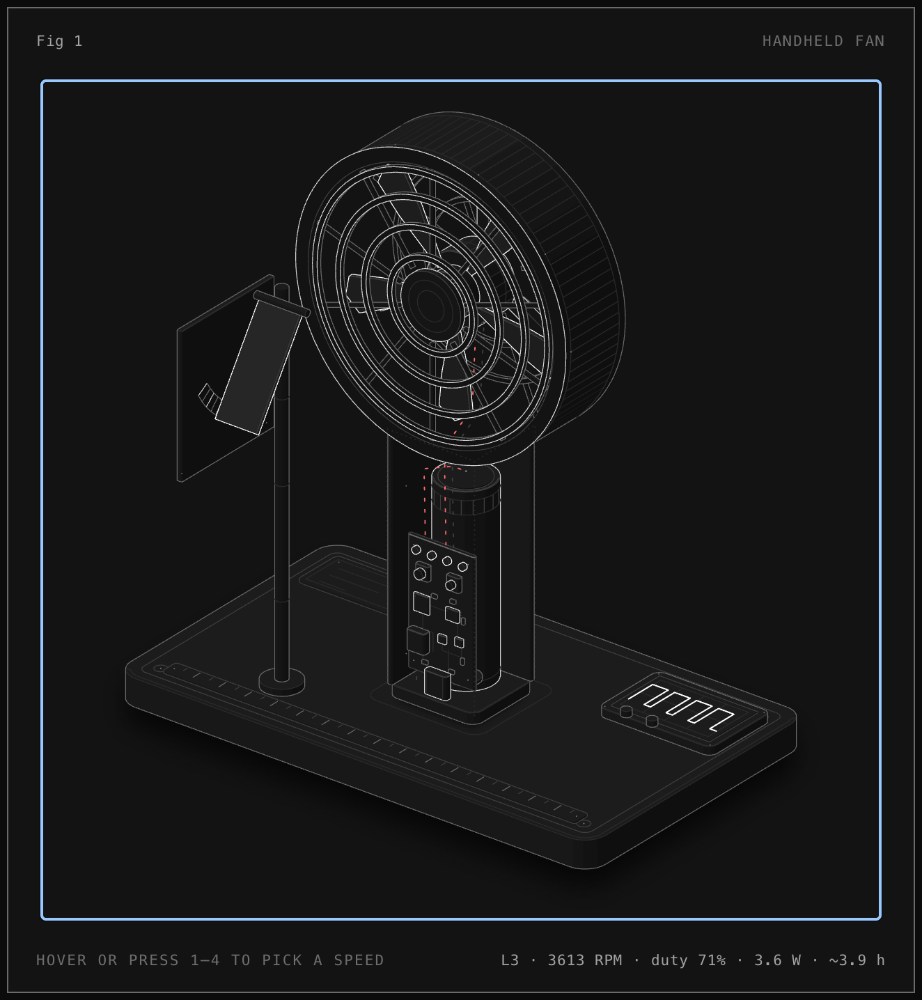

# Handheld fan: how it works

An interactive isometric figure of a USB-C rechargeable handheld fan with its handle opened up.
Pick a speed level and the rotor, the level LEDs, the PWM waveform on the scope, the wire flow,
the airflow vane and the readout all follow one small model.



Open `handheld-fan.html` (dark) or `handheld-fan-light.html` in a browser. Each is one
self-contained file with no network access.

- Hover, or press `1`-`4` / arrow keys, to choose a speed level.
- With no input it cycles through the levels by itself.
- Reduced-motion setting is respected (the rotor stays still).
- The rotor is drawn at 1/30 of real speed.

## What is measured and what is modelled

| | Source |
|---|---|
| PWM duty 35.7 / 50.6 / 70.6 / 100 % at 19.9 kHz | Measured, Gongtian F95D teardown |
| Speed 1565 / 2541 / 3613 / 4695 RPM | Measured, same teardown |
| 8 W max fan power, 5000 mAh 21700 cell (3.6 V, 18 Wh) | Printed on the label / cell |
| Fan power, airflow share, vane lean | **Modelled** from the fan affinity laws (flow ~ speed, pressure ~ speed^2, power ~ speed^3) |
| Battery runtime | **Modelled**: 90 % of 18 Wh over fan power + an assumed 0.5 W overhead |
| Geometry (104 mm head, 30 mm handle, part sizes) | Plausible, **not** from a drawing |

No measured airflow (CFM) was found, so airflow is shown only as a share of level 4.
Brushless motors are shown; older or cheaper fans use a brushed DC motor (see the iFixit teardown).

## Sources

- ChargerLAB, [Teardown of the Yoobao Handheld Ice-Cool High-speed Mini Fan (F5i)](https://www.chargerlab.com/teardown-of-the-yoobao-handheld-ice-cool-high-speed-min-fan-f5i/)
- Zeruns, [Gongtian F95D Mini Fan Teardown & Analysis](https://blog.zeruns.top/archives/98.html)
- iFixit, [Portable Fan Teardown](https://www.ifixit.com/Teardown/Portable+Fan+Teardown/100268)
- Wikipedia, [Affinity laws](https://en.wikipedia.org/wiki/Affinity_laws)

## Rebuilding

`build.mjs` imports the drawing kit from the Anatomy skill by relative path, so it only builds
with this layout:

```
<workspace>/
  skills/anatomy/        github.com/wheresryan22/anatomy, commit dbf697a
  figures/handheld-fan/  this repository
```

```sh
node build.mjs          # handheld-fan.html
node build.mjs --light  # handheld-fan-light.html
```

Node 20.10 or later. The built HTML files do not need the skill.

## Credits

The figure is built with [Anatomy](https://github.com/wheresryan22/anatomy) by Ryan
(MIT licence, (c) 2026 Ryan). Its drawing kit is inlined into each built HTML file.
The kit's source is not stored as separate files here, but because it is inlined into the HTML, its MIT notice is included as `THIRD_PARTY_LICENSE_anatomy.txt`.

## Known limits

- Touch controls are not implemented yet: on a phone only the automatic tour works.
- The Anatomy skill's formal geometry audit (`--audit`) was not run; draw order was tuned by eye
  and checked in screenshots. The line-end check (`scripts/lines.mjs`) passes with 0 of 288 ends floating.
- Chips on the back of the board and the motor windings are not drawn; the blades are flat.
